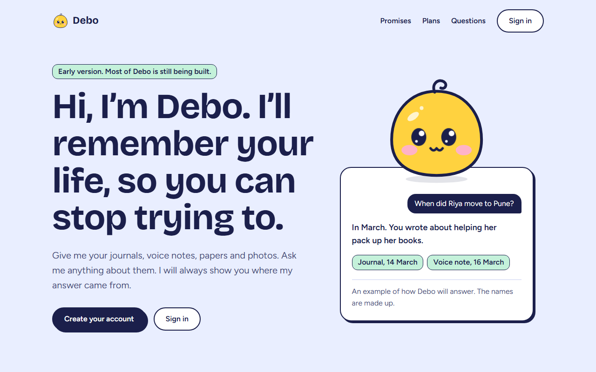
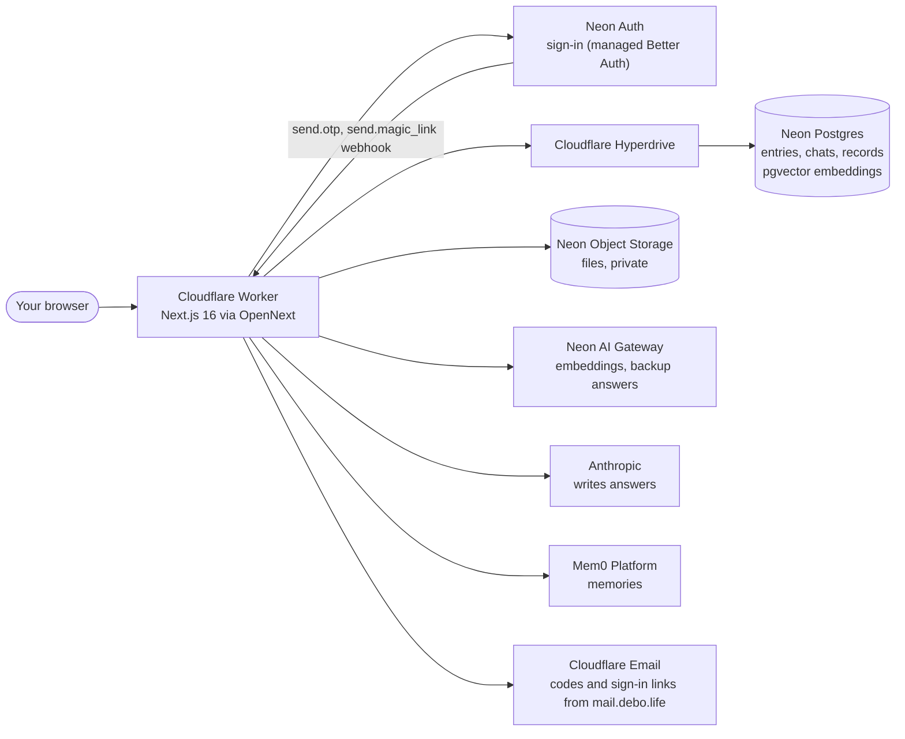

<p align="center">
  
</p>

<p align="center"><strong>A friendly assistant that remembers your life, and always shows where it learned it.</strong></p>

<p align="center">
  <a href="https://debo.life">Website</a> ·
  <a href="https://debo.life/privacy">Privacy</a> ·
  <a href="./docs/ROADMAP.md">Roadmap</a> ·
  <a href="./docs/DECISIONS.md">Decisions</a>
</p>

<p align="center">
  <a href="https://github.com/playlikeboy/debo.life/actions/workflows/deploy.yml"></a>
  
  
</p>

## What Debo is

Debo keeps the bits of your life in one place: what you write today, and later your voice notes, papers and photos. You can ask it anything about your own life in plain words, like "When did Riya move to Pune?" or "What did the doctor say in March?".

Every answer links to the entry it came from. If Debo has nothing about a question, it says so instead of guessing. You can see, fix and forget anything Debo knows, download all of it, or delete your account and everything with it.

Debo is for people who want to remember their own life better without building a system for it. You do not need to be technical. If you already keep a journal or record voice notes and can never find anything again, Debo is for you.

## What works today

Debo is an early version. It runs at [debo.life](https://debo.life). Some parts are built and some are still planned.

| Feature | Status | Notes |
|---|---|---|
| Accounts | Built | Sign up with email and password, and confirm your email with a 6-number code. Sign in with your password, a code by email, or a link by email. |
| Journal | Built | Write, edit and delete entries on your own journal page. A draft is kept in your browser, with a word count and "Find an entry". |
| Ask about your life | Built | Answers come only from your own entries, with source chips that open the entry. No source, no answer. |
| Search by meaning and by words | Built | Keyword search and meaning search (embeddings in Postgres with pgvector), merged. |
| Chat with Debo | Built | `/home/chat`. Answers stream in word by word. Chats are saved, and you can come back to them or delete them. |
| What Debo knows | Built | `/home/memories`. Memories picked out of your entries, each with its source. Fix or forget any of them. Runs on the hosted Mem0 Platform, and is switched off when no Mem0 key is set. |
| What Debo did | Built | `/home/activity`. A plain list of what Debo saved, changed, deleted and answered. Ids and times only, never your words. |
| Download everything | Built | A zip with each entry as Markdown, your chats and your activity record. It opens without Debo. |
| Delete your account | Built | Deletes your entries, chats, memories, files, records and sign-in, right away. |
| Daily AI limit | Built | Each person has a daily limit, so one account cannot run up the bill. |
| Privacy page | Built | [debo.life/privacy](https://debo.life/privacy) says what is stored, where, and who else sees it. |
| Voice notes, papers and photos | Planned | Phase 1. File storage is set up; uploads are not built yet. |
| Talk to Debo by voice | Planned | Phase 3. The LiveKit worker is wired but switched off. |
| Connect your apps | Planned | Phase 4. The Composio wrapper is wired but switched off. |
| Use Debo's memory in other AI tools (MCP) | Planned | Phase 4. Libraries installed, no code yet. |
| Plans and "use your own key" | Planned | Phase 5. |

The full plan, in order, is in [`docs/ROADMAP.md`](./docs/ROADMAP.md).

<p align="center">
  
</p>

## Seven promises

Debo is still early, so not all of these are true yet. They are the rules it is being built by.

1. **Your data is yours.** We will not sell it, share it or show ads against it.
2. **No AI training on your life.** Not by us, and we will pick AI providers who agree to the same.
3. **Debo shows its sources.** Every answer links to where it came from. No source, no answer.
4. **You can fix or forget anything.** Forgetting really deletes it.
5. **You can leave with everything.** Download all of it, or delete your account and all of it goes.
6. **Debo asks first.** Before reading from a new app or doing anything outside Debo.
7. **Nothing happens in secret.** Debo keeps a plain list of what it did, and you can read all of it.

How we keep them is in [`docs/PRIVACY-AND-TRUST.md`](./docs/PRIVACY-AND-TRUST.md).

## How it works



- **One answer pipeline.** Every question, from the home page or the chat, goes through `apps/web/src/lib/ask.ts`. It searches only your own entries, checks your daily limit, asks the model to answer from those pieces only, and records usage and activity.
- **One door for models.** Only `@debo/llm` calls a model: Anthropic first, the Neon AI Gateway if Anthropic fails.
- **Your data stays tied to you.** Every table that holds your data has your user id, and deleting your account deletes all of it.

Why each choice was made is in [`docs/DECISIONS.md`](./docs/DECISIONS.md).

## Tech stack

| Job | Used |
|---|---|
| Web app | Next.js 16 App Router, React 19, TypeScript, Tailwind CSS 4, on Cloudflare Workers through OpenNext |
| Workspace | pnpm workspaces, Turborepo |
| Database | Neon Postgres with pgvector, Drizzle ORM, node-postgres, Cloudflare Hyperdrive |
| Sign-in | Neon Auth (managed Better Auth), `@neon/auth` |
| File storage | Neon Object Storage (S3 API) |
| Answers and embeddings | Anthropic and the Neon AI Gateway, through the AI SDK, behind `@debo/llm` |
| Memory | Mem0 Platform, behind `@debo/memory` |
| Chat | CopilotKit with AG-UI, on our own answer pipeline |
| Background jobs | Inngest (installed, not used yet) |
| Voice | LiveKit Agents (wired, switched off) |
| Connectors | Composio (wired, switched off) |
| Validation | Zod |
| Tests | Vitest, Playwright |

## What is in this repo

```
apps/
  web/           The website and the app: Next.js on Cloudflare Workers
  voice-agent/   LiveKit voice worker, switched off until its keys are set
  mcp-server/    MCP server for other AI tools (libraries installed, no code yet)
packages/
  db/            Database schema, migrations and queries. The only package that talks to Postgres.
  llm/           Model calls, embeddings and the answer rules
  memory/        What Debo knows, through the Mem0 Platform
  ingest/        File storage and making entries searchable
  connectors/    Connect other apps through Composio, switched off
  recall/        Recall test set: made-up entries and questions
  ui/            Shared components (planned, no code yet)
docs/            The plan, the rules and the decisions
```

Package rules are in [`docs/MONOREPO.md`](./docs/MONOREPO.md).

## Quick start

You need Node 22 or newer, pnpm 10 and the [Neon CLI](https://neon.com/docs/reference/neon-cli).

```bash
pnpm install
pnpm dev
```

Open http://localhost:3000. The landing page needs no environment variables.

To sign in and use the app, you also need a Neon project:

```bash
neon login          # opens a browser to sign in to Neon
neon env pull       # in the repo root; writes the Neon values into .env
```

Then add the values Neon does not make for you to `.env`:

- `NEON_AUTH_COOKIE_SECRET`: make one with `openssl rand -base64 32`
- `ANTHROPIC_API_KEY`: your Anthropic API key
- `MEM0_API_KEY`: optional; without it, "What Debo knows" is switched off

Create the tables and start the app:

```bash
pnpm --filter @debo/db db:migrate
pnpm dev
```

`.env` is git-ignored. The full list of accounts and values is in [`docs/SETUP.md`](./docs/SETUP.md) and [`.env.example`](./.env.example) (names only).

## Scripts

| Command | What it does |
|---|---|
| `pnpm dev` | Run the app locally |
| `pnpm build` | Build everything |
| `pnpm typecheck` | Check types in every package |
| `pnpm test` | Run the unit tests (Vitest) |
| `pnpm --filter @debo/db db:generate` | Make a migration after changing the schema |
| `pnpm --filter @debo/db db:migrate` | Apply migrations |
| `pnpm --filter @debo/db db:backfill-embeddings` | Make entries saved before meaning search searchable by meaning |
| `pnpm --filter @debo/recall recall` | Run the recall test set |
| `pnpm --filter @debo/web test:e2e` | Run the end-to-end test in a real browser |
| `pnpm --filter @debo/web deploy` | Build and deploy to Cloudflare (normally CI does this) |

## Testing

- **Unit tests:** `pnpm test` runs Vitest in every package.
- **End-to-end test:** [`apps/web/e2e/journal.spec.ts`](./apps/web/e2e/journal.spec.ts) walks the whole loop with a throwaway account: sign up, write, ask, edit, read the activity record, chat, delete the entry, delete the account. It uses made-up data and deletes its own account.

```bash
npx playwright install chromium                                # once, in apps/web
pnpm --filter @debo/web test:e2e                               # against next dev on port 3000
BASE_URL=https://debo.life pnpm --filter @debo/web test:e2e    # against the live site
```

- **Recall test set:** `pnpm --filter @debo/recall recall` checks that search finds the right entries. Run it after any change to search, chunking or embeddings.

## Deploying

Every push to `main` deploys [debo.life](https://debo.life) through [`.github/workflows/deploy.yml`](./.github/workflows/deploy.yml):

1. Install with pnpm and check types.
2. Apply database migrations.
3. Build with OpenNext and deploy to Cloudflare Workers.
4. Check that debo.life answers.

Secrets live in Cloudflare (Worker secrets) and GitHub (repository secrets), never in the repo. Details are in [`docs/SETUP.md`](./docs/SETUP.md).

## Docs

| Doc | What it covers |
|---|---|
| [`AGENTS.md`](./AGENTS.md) | Rules for anyone, human or AI, working here. Start here. |
| [`DESIGN.md`](./DESIGN.md) | Look, feel, colours, type, patterns |
| [`docs/PRODUCT.md`](./docs/PRODUCT.md) | What Debo is, who it is for, features |
| [`docs/WRITING.md`](./docs/WRITING.md) | Plain-English rules for all text |
| [`docs/ARCHITECTURE.md`](./docs/ARCHITECTURE.md) | How the parts fit together |
| [`docs/MONOREPO.md`](./docs/MONOREPO.md) | Folder layout and package rules |
| [`docs/DATA-MODEL.md`](./docs/DATA-MODEL.md) | Database tables |
| [`docs/MEMORY.md`](./docs/MEMORY.md) | How Debo remembers and recalls |
| [`docs/VOICE.md`](./docs/VOICE.md) | Talking to Debo |
| [`docs/CONNECTORS.md`](./docs/CONNECTORS.md) | Connecting other apps |
| [`docs/BYOK-AND-PLANS.md`](./docs/BYOK-AND-PLANS.md) | Your own key, plans, billing |
| [`docs/PRIVACY-AND-TRUST.md`](./docs/PRIVACY-AND-TRUST.md) | Promises about data, and how we keep them |
| [`docs/ROADMAP.md`](./docs/ROADMAP.md) | Build order and what's next |
| [`docs/DECISIONS.md`](./docs/DECISIONS.md) | Why we chose what we chose |
| [`docs/SETUP.md`](./docs/SETUP.md) | Accounts, secrets, running locally, deploying |

## Contributing

Read [`CONTRIBUTING.md`](./CONTRIBUTING.md) and [`AGENTS.md`](./AGENTS.md) first. Keep changes small, write in plain English, and never claim something works until it does.

## Security

Please do not report security problems in public issues. Read [`SECURITY.md`](./SECURITY.md) for how to report one.

## Licence

Not chosen yet. Until a `LICENSE` file is added, all rights are reserved by the owner.

<p align="center">
  <br>
  Being built in the open by one person.
</p>
